# CareConnect Web

A healthcare operations platform for group homes and Direct Support Professionals (DSPs). CareConnect streamlines client care, staff management, behavioral documentation, scheduling, and operational reporting through role-based access controls.

## Screenshots

Screenshots from the [CareConnect case study on jaelyncuellar.com](https://jaelyncuellar.com/projects/careconnect) - the same image files are kept in this repo under `docs/portfolio/`.

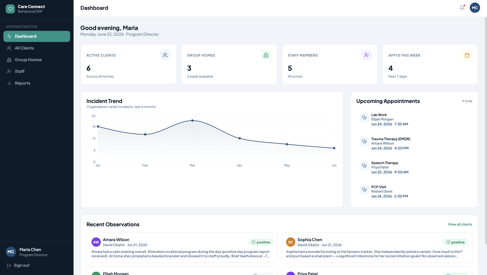

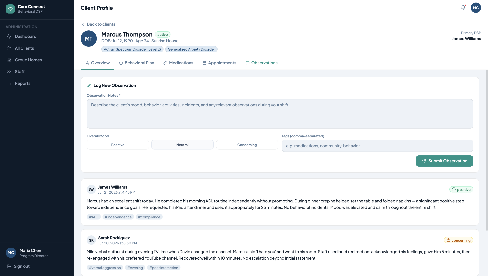

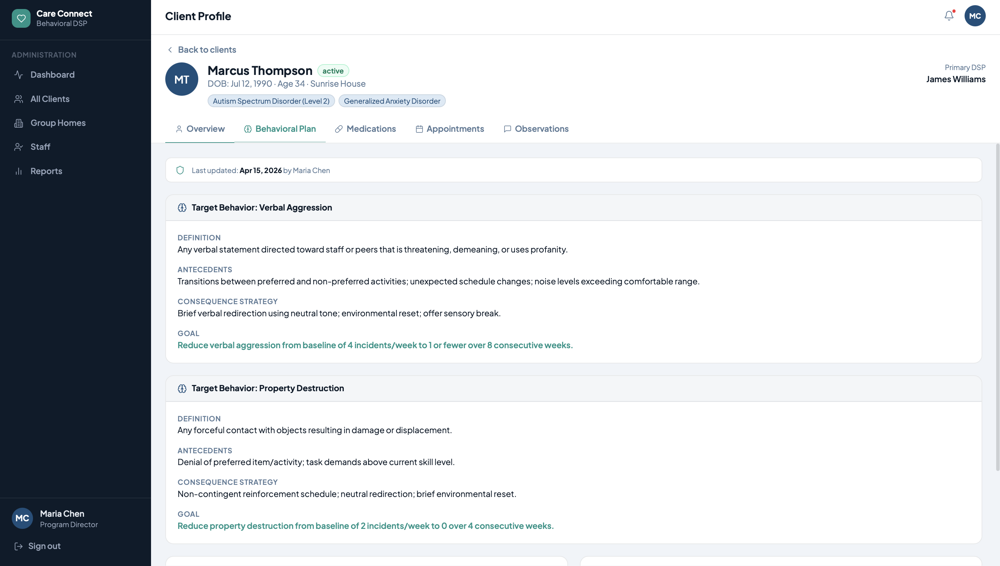

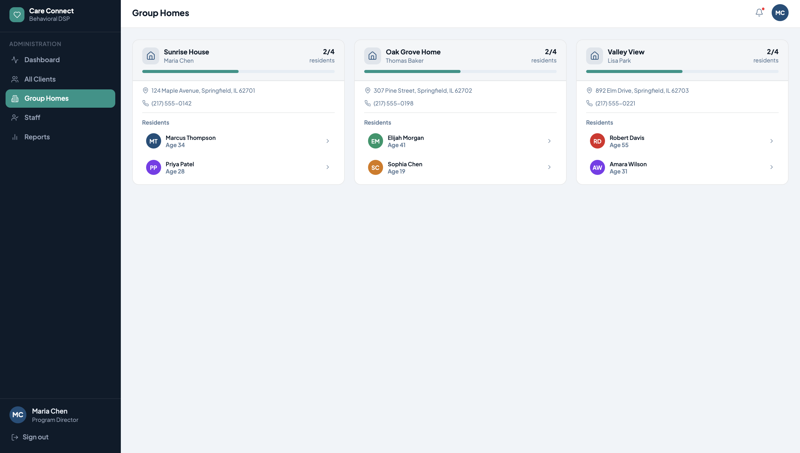

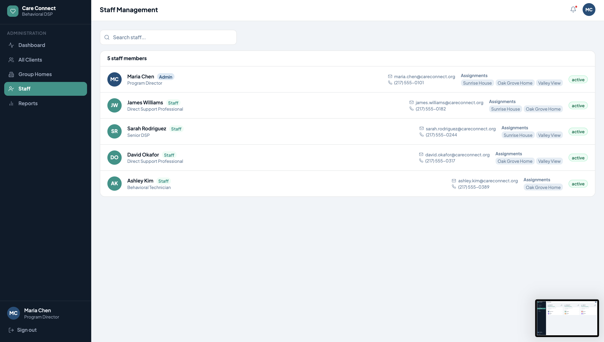

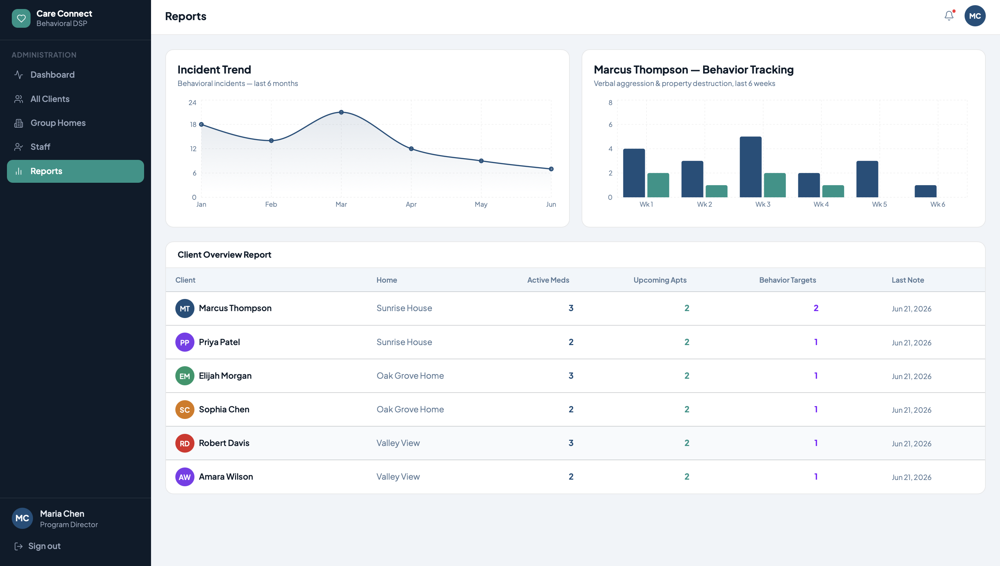

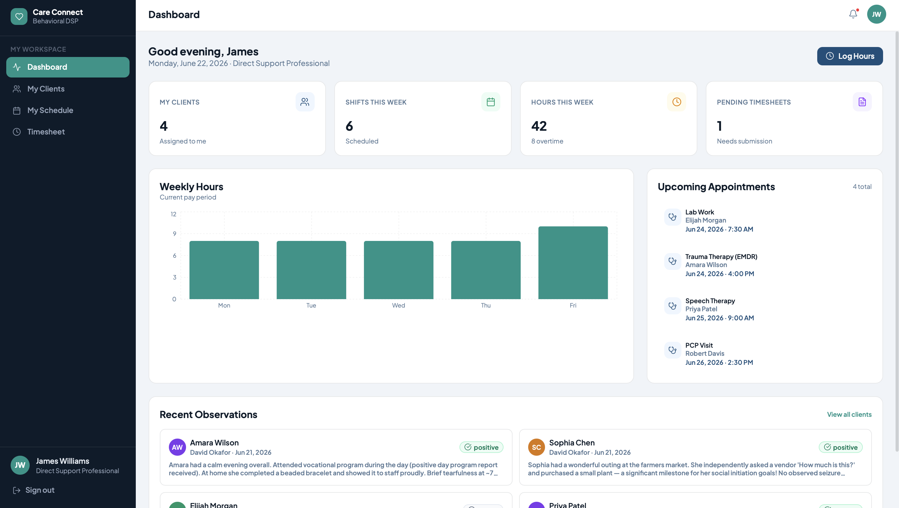

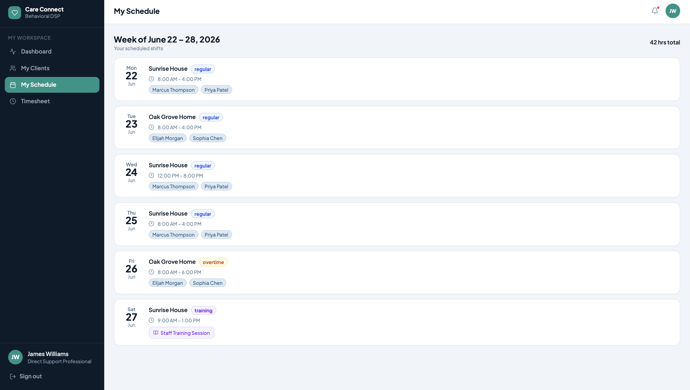

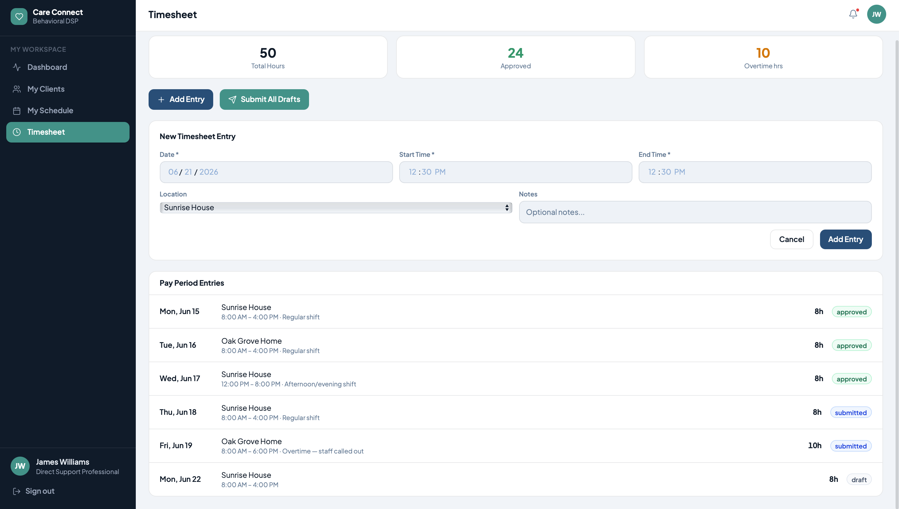

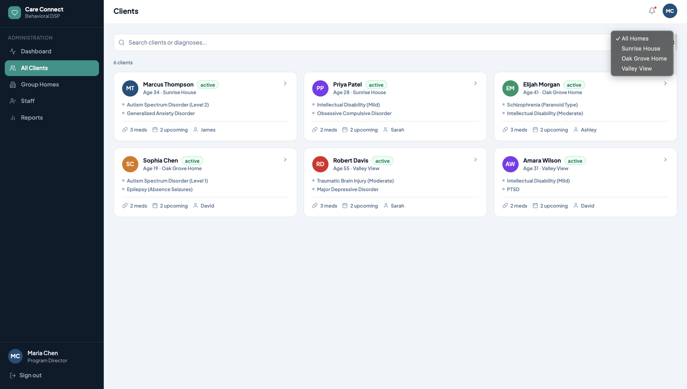

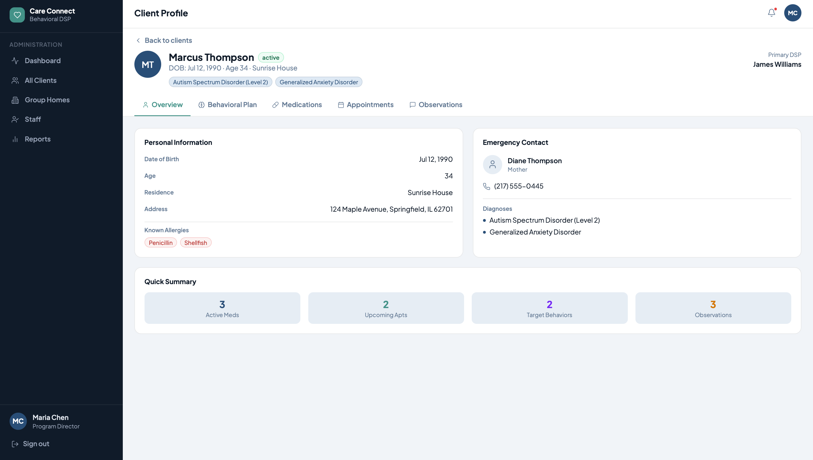

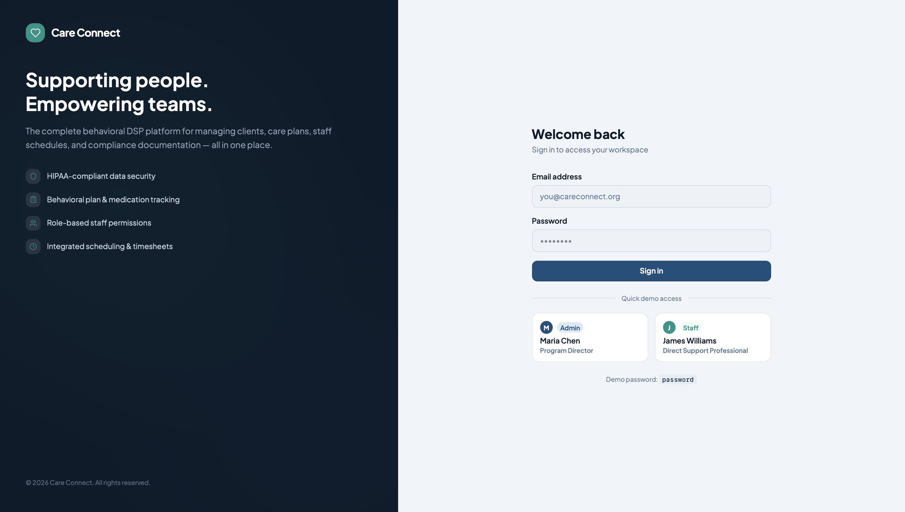


## Features

- **Role-based access** — Separate Admin and Staff experiences with scoped navigation and permissions
- **Client management** — Detailed care profiles with overview, diagnoses, contacts, and status tracking
- **Behavioral support** — Behavioral plans with target behaviors, strategies, reinforcers, and observation logging
- **Medications & appointments** — Medication lists with prescriber info and appointment scheduling with status tracking
- **Scheduling & timesheets** — Staff schedule views and timesheet submission with draft / submitted / approved workflow
- **Group homes** — Home occupancy, resident assignments, and manager oversight
- **Staff management** (Admin) — Staff directory with roles, assignments, and employment status
- **Analytics & reporting** (Admin) — Operational dashboards with charts for census, staffing, and care trends

## User Roles

### Admin
- Organization-wide visibility across clients, staff, and group homes
- Staff management and operational oversight
- Reporting and analytics dashboards

### Staff (DSP)
- Personalized dashboard with assigned clients and homes
- Schedule and timesheet management
- Observation notes and care documentation

## Tech Stack

- **Framework:** React 18 + TypeScript + Vite
- **Styling:** Tailwind CSS 4, shadcn/ui (Radix primitives)
- **Charts:** Recharts
- **Icons:** Lucide React
- **State:** Local React state with mock data layer (no backend required for demo)

## Getting Started

### Prerequisites
- Node.js 18+ 
- npm

### Installation

```bash
npm install
```

### Development

```bash
npm run dev
```

Open http://localhost:5173 in your browser.

### Production Build

```bash
npm run build
```

The build output is generated in `dist/`.

## Demo Access

This is a frontend demo with an in-memory data layer. Use the quick demo buttons on the login screen, or sign in manually:

- **Admin:** `maria.chen@careconnect.org` / `password`
- **Staff:** `james.williams@careconnect.org` / `password`

## Project Structure

```
src/
  app/
    App.tsx              # App shell, routing, views, and mock data
    components/
      ui/                # shadcn/ui component library (Radix-based)
  styles/
    index.css            # CSS entrypoint
    theme.css            # Design tokens
    tailwind.css         # Tailwind import
    fonts.css            # Font imports
  main.tsx               # React entrypoint
```

## Deployment

This app is a static Vite build and can be hosted on any static host.

A production build is published on the `gh-pages` branch (contains the built `index.html` + `assets/` only). To serve it with GitHub Pages:

1. In the repo, go to **Settings → Pages**
2. Under **Build and deployment**, select **Deploy from a branch** as the source
3. Choose the `gh-pages` branch and `/ (root)` folder, then save

The site will be live at `https://jaelyncuellar.github.io/careConnect-web/` after a minute or two.

Alternatively, deploy `dist/` to Vercel, Netlify, or any static file host.

## Purpose

Built to demonstrate modern healthcare administration workflows: behavioral support documentation, medication and appointment coordination, staff scheduling, and operational reporting in a responsive, accessible interface.

## License

All rights reserved. Demo project for portfolio purposes.